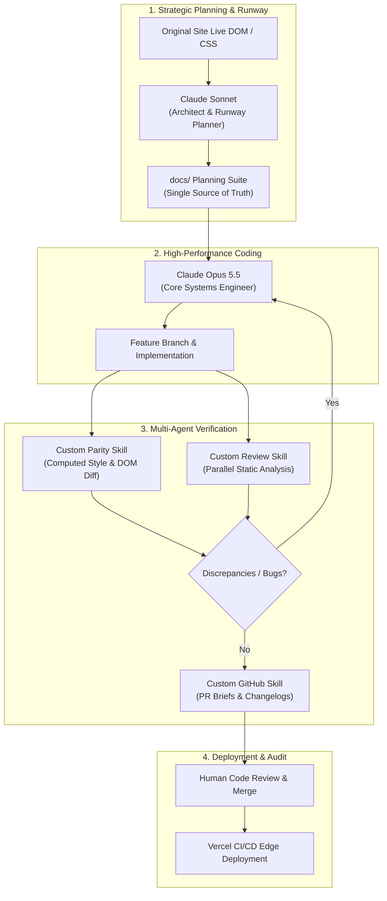

# How We Built It: Orchestrating an Autonomous Multi-Model AI Squad

> **A pixel-identical, production-grade reconstruction of [TeddyPups U.A.E.](https://puppy.instabizweb.com), built through disciplined AI Systems Orchestration. Engineered with dual-tier LLM reasoning, specialized custom agent skills, automated visual parity harnesses, and enterprise-grade documentation.**

🌐 **Live Production:** [puppy-website-clone.vercel.app](https://puppy-website-clone.vercel.app)  
📁 **Architecture & Specs:** [`docs/`](docs/)

---

## Executive Summary & Engineering Metrics

| Metric | Measurement / Specification |
| :--- | :--- |
| **Tech Stack** | Next.js 16 (App Router, Turbopack) · React 19 · TypeScript 5 (Strict) · Tailwind CSS v4 · Zustand · Lenis |
| **System Scale** | 50+ prerendered static routes · 42 puppy profile engines · 64-photo media wall · Honeypot API · ~7,400 LOC TypeScript |
| **Visual Parity** | **0px deviation**: exact vertical height match at mobile viewports (Home: `12,904px` vs `12,904px`) |
| **AI Architecture** | **Dual-Model Tiering**: Claude Sonnet (Architecture & Planning) + Claude Opus 5.5 (Core Implementation) |
| **Tooling & Skills** | Custom Automated Code Review Skill · Custom DOM & Parity Diffing Skill · Custom GitHub Lifecycle Skill |
| **Delivery Track** | 13 structured PR milestones with comprehensive technical briefs · 8 versioned planning documents |

---

## The AI Orchestration Architecture

Rather than relying on ad-hoc prompts or unconstrained generation, this project was executed using an **Agentic Operating Model**. I served as the **Lead Systems Architect & Human-in-the-Loop Evaluator**, steering specialized models and custom skills through strict delivery gates.



---

## 1. Dual-Model Tiering: Strategic Separation of Concerns

We decoupled high-level strategic reasoning from low-level component synthesis to maximize execution quality:

*   **Claude Sonnet (Strategic Brainstorming & Milestone Runway):**
    *   Synthesized raw design tokens and layout hierarchies into discrete, dependency-mapped milestones.
    *   Drafted the system runway in [`docs/tasks.md`](docs/tasks.md) and established architectural boundaries in [`docs/architecture.md`](docs/architecture.md).
    *   Formulated failure modes, test criteria, and edge-case roadmaps prior to code execution.
*   **Claude Opus 5.5 (Core Implementation & Algorithmic Synthesis):**
    *   Wrote all production TypeScript code under strict type-checking settings.
    *   Implemented complex mathematical animations, procedural SVG rigging (`lerpPose`), and seeded deterministic random generation for hand-drawn aesthetic borders.
    *   Engineered clean, accessible, zero-dependency state machines using Zustand.

---

## 2. Specialized Custom Skills & Automated Tooling

Standard LLM workflows fail when dealing with sub-pixel nuances and codebase-wide regressions. We engineered custom tooling skills to automate quality enforcement:

### A. Custom Visual & DOM Parity Skill
*   **Dual-Headless Inspection:** Simultaneously spawned the live target site and local Next.js build inside an automated Chrome DevTools protocol session at synchronized viewports (`1440×900` desktop, `390×844` mobile).
*   **Deep Computed-Style Diffing:** Extracted and diffed computed CSS rules, layout bounding boxes, cascade-layer precedence, and typography line-heights.
*   **High-Value Catches:** Identified 14 gallery photos where EXIF orientation flipped aspect ratios, and caught a 2px heading discrepancy caused by Tailwind v4 cascade layer ordering.

```
Mobile Viewport Height Verification (390 × 844)
────────────────────────────────────────────────────────
Route               Target Site      Clone        Delta
/ (Home)            12,904 px        12,904 px     0 px
/puppies             5,639 px         5,639 px     0 px
/how-it-works        7,810 px         7,810 px     0 px
/happy-families     10,759 px        10,761 px    +2 px (intentional font clamp fix)
────────────────────────────────────────────────────────
```

### B. Custom Code Review Skill
*   Runs isolated multi-agent audits reviewing distinct architectural planes:
    *   **Agent Alpha:** Route handlers, API safety, honeypot validation, mutation surface.
    *   **Agent Beta:** Hydration boundaries, React 19 hooks, client/server split, accessibility tree.
*   **Zero-Hallucination Validation Protocol:** Findings are cross-examined against AST reality and the target site before being flagged. Out of 7 reported findings, 2 were rejected as false positives (mirroring deliberate upstream behaviors) and 5 were validated and resolved in PR #12.

### C. Custom GitHub Lifecycle Skill
*   Enforced Conventional Commits (`feat:`, `fix:`, `chore:`, `refactor:`).
*   Maintained milestone branch isolation, ensuring no code merged into `main` without automated test passes and formatted PR documentation stored under [`docs/pull-requests/`](docs/pull-requests/).

---

## 3. The `docs/` Single Source of Truth

Rather than letting LLMs rely on ephemeral context windows, all system knowledge was externalized into an immutable, versioned documentation repository:

```
docs/
├── Aim.md                 # Project manifesto & non-negotiable definition of "Done"
├── tasks.md               # Dynamic milestone runway & status board
├── context.md             # Measured design tokens (color variables, font scales, easings)
├── architecture.md        # State graph, component boundaries, route topologies
├── decisions.md           # Architecture Decision Records (ADRs) with tradeoffs
├── pr-plan.md             # Standardized Pull Request schema & milestone roadmaps
├── qa-checklist.md        # Systematic cross-browser QA matrices
├── qa-report.md           # Pixel-level mathematical diff reports
└── pull-requests/         # Complete audit trail of all 13 milestone pull requests
```

---

## 4. Key Engineering Innovations

*   **Procedural SVG Character Rigging (Teddy):** Mascot is rendered entirely via vector math rather than static image assets. Incorporates a discrete pose matrix (`sit`, `peek`, `walk`, `bow`, `snug`, `sniff`) with a custom numerical interpolator (`lerpPose`) for smooth, reactive state changes.
*   **Deterministic Procedural Framing:** Sketchbook card outlines are computed via seeded pseudo-random algorithms, ensuring unique organic curves that match perfectly across Server-Side Rendering (SSR) and Client Hydration without hydration mismatches.
*   **Zero-Dependency Form Security:** Custom lightweight honeypot layer and schema validator on `/api/enquiry` protecting against bot abuse with zero third-party overhead.
*   **Performance & Core Web Vitals:** Static site prerendering for 50+ routes, zero-request self-hosted variable typography, optimized modern AVIF/WebP image pipelines, and full accessibility compliance (`prefers-reduced-motion`, WAI-ARIA dialogs and tablists).

---

## 5. Architectural Retrospective

1. **AI Amplification Requires Systems Discipline:** AI does not replace architecture; it accelerates it. High-leverage outcomes are achieved only when models operate against rigorous documentation and explicit schemas.
2. **Measurement Over Observation:** Eyeballing visual fidelity yields invisible errors. Automated DOM diffing and pixel measurements turned aesthetic replication into an exact science.
3. **Structured Review Eliminates Drift:** Multi-agent reviews combined with validation filters prevent hallucinations from polluting production branches.
